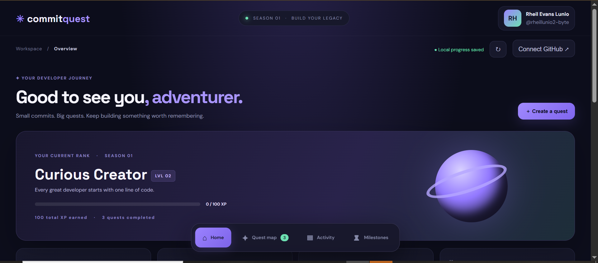
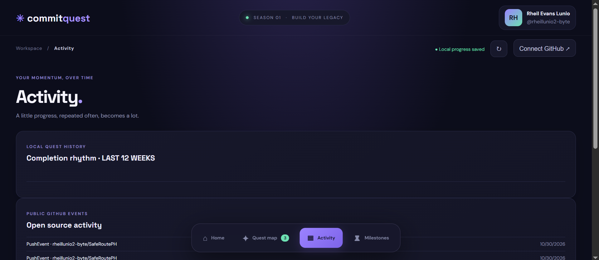
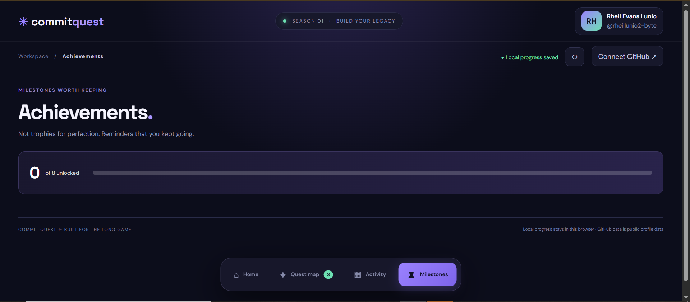

# ✦ Commit Quest


**Your developer journey, reimagined as an adventure.**

Welcome to **Commit Quest**, a game-inspired developer dashboard that transforms personal coding goals into exciting quests. Create goals, complete tasks, earn experience points (XP), build activity streaks, unlock milestones, and connect your GitHub profile to track your developer journey.

Whether you're learning your first programming language, building projects, or contributing to open source, Commit Quest helps you stay motivated and make progress one quest at a time.

**Small commits. Big quests. Keep building.**

---

## 📸 Screenshots

<table>
  <tr>
    <td align="center">
      
      <br>
      <b>Home</b>
    </td>
    <td align="center">
      
      <br>
      <b>Quest Map</b>
    </td>
  </tr>
  <tr>
    <td align="center">
      
      <br>
      <b>Activity</b>
    </td>
    <td align="center">
      
      <br>
      <b>Milestone</b>
    </td>
  </tr>
</table>

---

## 🎯 Project Overview

Commit Quest combines personal productivity with RPG-inspired progression mechanics. Instead of treating development goals as an ordinary checklist, it turns them into quests with visible rewards, progress tracking, and achievements.

The concept is simple:

1. Set a development goal.
2. Turn it into a quest.
3. Complete your tasks.
4. Earn experience points (XP).
5. Track your activity and progress.
6. Unlock milestones and achievements.

The application features a modern dark interface with purple accents, interactive quest cards, progress indicators, and a developer-focused dashboard.

---

## ✨ Features

### 🏠 Developer Home
- View your current developer rank and level.
- Track total XP and completed quests.
- Monitor your activity streak.
- View active quests and weekly progress.
- Check your connected GitHub profile.

### 🗺️ Quest Map
- Create personal development quests.
- Add quest titles and descriptions.
- Organize quests by category:
  - Building
  - Learning
  - Open Source
  - Career
  - Personal
- Assign XP rewards.
- Filter quests by their completion status.
- Complete quests and earn experience points.

### 📈 Activity Tracking
- View your activity through a 12-week heatmap.
- Review recently completed quests.
- Monitor your development consistency.
- View recent public GitHub activity.

### 🏆 Milestones and Achievements
- Unlock achievements through completed quests.
- Track XP milestones.
- Build activity streaks.
- Monitor achievement progress.
- Celebrate development milestones.

### ⌘ GitHub Integration
- Connect using your public GitHub username.
- Display public profile information.
- View public repositories.
- Display recent public GitHub events.
- No GitHub password or personal access token required.

### 💾 Local Progress Saving
- Uses browser `localStorage`.
- Saves quest information and progress.
- Retains supported data after refreshing the page.
- No account registration or backend required.

---

## 🛠️ Built With

| Technology | Purpose |
|---|---|
| HTML5 | Application structure |
| CSS3 | Styling, animations, and responsive layout |
| JavaScript (ES6+) | Application logic and interactions |
| GitHub REST API | Public GitHub information |
| Browser localStorage | Local progress saving |
| Google Fonts | Typography |

### Development Tools
- Visual Studio Code
- Git and GitHub
- Live Server Extension
- Modern web browser

---

## 🚀 Getting Started

You can run Commit Quest locally without installing a backend or configuring API keys.

### Prerequisites

Make sure you have:

- A computer running Windows, macOS, or Linux.
- Visual Studio Code or another code editor.
- A modern web browser.
- Git (optional).
- Live Server Extension for VS Code (recommended).
- Internet connection for GitHub API requests and external fonts.

### Installation

**1. Clone the repository**

```bash
git clone https://github.com/rheillunio2-byte/CommitQuest.git
```

**2. Navigate to the project folder**

```bash
cd CommitQuest
```

**3. Open the project in VS Code**

```bash
code .
```

**4. Run the application**

Open `index.html` using the Live Server extension.

Alternatively, open the HTML file directly in your browser.

**5. Start your journey!**

Create your first quest, complete tasks, earn XP, and track your progress.

---

## 🕹️ How to Use

1. Launch Commit Quest.
2. Explore the Home dashboard.
3. Navigate to the Quest Map.
4. Create a development quest.
5. Choose a category and XP reward.
6. Complete your quest to earn XP.
7. Visit Activity to review your progress.
8. Open Milestones to view achievements.
9. Optionally connect your public GitHub profile.

**Tip:** Break large development goals into smaller quests. Consistent progress is better than waiting for the perfect moment to start.

---

## 🔌 GitHub API Integration

Commit Quest uses the GitHub REST API to retrieve publicly available information.

| Endpoint | Purpose |
|---|---|
| `/users/{username}` | Public profile information |
| `/users/{username}/repos` | Public repositories |
| `/users/{username}/events/public` | Recent public activity |

### Important Notes
- No GitHub password or personal access token is required.
- Only publicly available information is retrieved.
- Unauthenticated GitHub API rate limits apply.
- Private repositories and private activity are not displayed.
- An internet connection is required for API requests.

For additional information, visit the [GitHub REST API Documentation](https://docs.github.com/en/rest).

---

## 📂 Project Structure

```text
CommitQuest/
│
├── index.html
├── styles.css
├── app.js
├── README.md
├── CONTRIBUTING.md
├── LICENSE
├── .gitignore
│
└── images/
    ├── Home.PNG
    ├── Quest Map.PNG
    ├── Activity.PNG
    └── Milestone.PNG
```

### Main Files

- `index.html` - Main application structure and interface.
- `styles.css` - Visual design, layout, and animations.
- `app.js` - Quest mechanics, XP system, achievements, and interactions.
- `README.md` - Project documentation.
- `CONTRIBUTING.md` - Contribution guidelines.
- `LICENSE` - Project license.
- `images/` - Screenshots and project assets.

---

## 🧠 Project Objectives

Commit Quest aims to encourage developers to develop:

- Consistent programming habits.
- Better time management.
- Goal-setting and task management.
- Self-discipline and productivity.
- Motivation through progress tracking.
- Continuous learning and improvement.

---

## ⚠️ Limitations

- The current version is a frontend-based application.
- Player progress is stored locally in the browser.
- Progress is not automatically synchronized between devices.
- There is no online multiplayer or global leaderboard.
- GitHub integration is limited to publicly available information.
- GitHub API rate limits may affect requests.
- XP and achievements are motivational features rather than verified measures of programming ability.

---

## 🔮 Future Development

Possible improvements and planned features include:

- [ ] Additional quest categories and templates.
- [ ] Recurring quests and task deadlines.
- [ ] More developer ranks and achievements.
- [ ] Customizable player profiles.
- [ ] Improved GitHub statistics and visualizations.
- [ ] Cloud-based progress synchronization.
- [ ] Team quests and collaborative challenges.
- [ ] Global leaderboard.
- [ ] Additional themes and customization options.
- [ ] Progress export and import functionality.

---

## 🤝 Contributing

Contributions, suggestions, and improvements are welcome!

You can help improve Commit Quest by:

- Reporting bugs.
- Suggesting new features.
- Improving the user interface.
- Enhancing existing functionality.
- Improving GitHub integration.
- Updating documentation.

Please read [CONTRIBUTING.md](CONTRIBUTING.md) before submitting changes.

---

## 🔒 Privacy and Security

Commit Quest currently operates as a frontend-based application.

- No account registration is required.
- Quest progress is stored using browser `localStorage`.
- Progress is limited to the browser and device being used.
- Clearing browser data may remove saved progress.
- GitHub integration only retrieves public information.
- Avoid storing sensitive personal information in the application.

---

## 👨‍💻 Developer

**Developed by RETL**

GitHub: [@rheillunio2-byte](https://github.com/rheillunio2-byte)

Commit Quest is an independent project created to make developer productivity more interactive, engaging, and enjoyable.

---

## 📜 License

This project is licensed under the MIT License. See the [LICENSE](https://github.com/rheillunio2-byte/Commit-Quest?tab=MIT-1-ov-file) file for details.

---

**Small commits. Big quests. Keep building.** ✦
